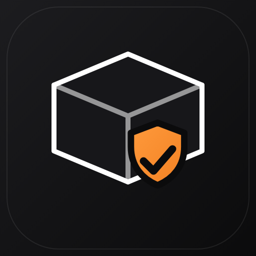

<div align="center">

# vinci-skills

**Practical agent skills from a small web and marketing studio.**
Gerçek işlerden çıkan, test edilmiş, bağımlılığı az ajan skill'leri.

[Vinci Studio](https://vincistudio.com.tr) · MIT license · Works with Claude Code and any agent that follows the SKILL.md standard

</div>

Each skill is a folder with a `SKILL.md`, small dependency-light scripts and a runnable example. Every script was run against sample input before release. No API keys, accounts or client data are included.

## Content and social

<table>
<tr>
<td width="96"></td>
<td><b><a href="skills/bilingual-content-gate">Bilingual Content Gate</a></b><br>
Pre-publish check for blog and news HTML in one or two languages: headings, FAQ, links, banned phrases, images and TR/EN parity. Never edits your content. Exit code 1 on errors.<br>
<i>İki dilli blog ve haber HTML'i için yayın öncesi kontrol.</i></td>
</tr>
<tr>
<td></td>
<td><b><a href="skills/instagram-carousel-renderer">Branded Carousel Renderer</a></b><br>
JSON in, 1080x1350 PNG slides, one PDF and a caption file out. Text is drawn by code, so accented and Turkish characters are never garbled.<br>
<i>JSON'dan markalı carousel; yazı kodla basıldığı için Türkçe karakter bozulmaz.</i></td>
</tr>
<tr>
<td></td>
<td><b><a href="skills/remotion-video-pipeline">Remotion Video Pipeline</a></b><br>
Raw phone or camera footage to a branded promo video: proxies, contact sheets for clip choice, a Remotion template and the render pitfalls that waste hours.<br>
<i>Ham görüntüden markalı tanıtım videosu.</i></td>
</tr>
</table>

## Delivery and business

<table>
<tr>
<td width="96"></td>
<td><b><a href="skills/client-handoff-package">Client Handoff Package</a></b><br>
Audit a project for secrets, internal notes, tool traces and local paths, then generate the client README, <code>.env.example</code> and a handoff PDF.<br>
<i>Müşteriye teslimden önce temizlik denetimi ve teslim belgeleri.</i></td>
</tr>
<tr>
<td></td>
<td><b><a href="skills/sourced-price-calibration">Sourced Price Calibration</a></b><br>
Calibrate calculator prices from published market sources with dates, medians, ranges and low-confidence flags, instead of copying one competitor.<br>
<i>Hesaplayıcı fiyatlarını yayınlanmış kaynaklardan kalibre etme.</i></td>
</tr>
<tr>
<td></td>
<td><b><a href="skills/payment-reminder-resend">Payment Reminder with Resend</a></b><br>
Sparse reminder emails for unpaid recurring bills until you mark them paid with a signed one-click link. Includes the due-date logic and cron wiring.<br>
<i>Ödenmemiş abonelik ve faturalar için seyrek hatırlatma e-postaları.</i></td>
</tr>
</table>

## Web engineering

<table>
<tr>
<td width="96"></td>
<td><b><a href="skills/ssr-animation-lcp-diagnosis">SSR Animation LCP Diagnosis</a></b><br>
Find entrance animations that ship invisible in server-rendered HTML and wreck Largest Contentful Paint. Includes the CSS-only fix and a PageSpeed median runner.<br>
<i>LCP'yi bozan SSR giriş animasyonlarını bulma ve düzeltme.</i></td>
</tr>
<tr>
<td></td>
<td><b><a href="skills/firestore-bulk-script-pattern">Firestore Bulk Script Pattern</a></b><br>
Safe one-off bulk changes: dry-run by default, explicit <code>--write</code>, JSON backup, batched commits under the 500-write limit, idempotent re-runs.<br>
<i>Firestore'da güvenli toplu değişiklik deseni.</i></td>
</tr>
<tr>
<td></td>
<td><b><a href="skills/recaptcha-enterprise-failopen">reCAPTCHA Enterprise Fail-Open</a></b><br>
Server-side reCAPTCHA Enterprise verification through the Assessment API: fail-open for public lead forms, fail-closed for login, and how to diagnose <code>invalid-input-response</code>.<br>
<i>Genel formlarda açık, giriş ekranında kapalı başarısızlık politikası.</i></td>
</tr>
</table>

## Install / Kurulum

Copy any folder from `skills/` into your project's `.claude/skills/` (or `~/.claude/skills/` for all projects). Each skill's `SKILL.md` lists its triggers and usage.

```bash
git clone https://github.com/kuzeyozel-1/vinci-skills.git
cp -R vinci-skills/skills/bilingual-content-gate .claude/skills/
```

Most scripts need **Node 18+**. The carousel renderer, video helpers and PDF export also use Google Chrome or Chromium (auto-detected; set `CHROME_PATH` to override).

## Why these exist

They come from running a small studio: publishing a bilingual blog every day, delivering client sites, chasing recurring bills and fixing production slowdowns. Each skill captures one problem that cost real hours, with the guardrails learned the hard way.

## Contributing

Issues and pull requests are welcome. Keep skills small, dependency-light and free of client data. Add a runnable example.

## License

MIT, see [LICENSE](LICENSE). Made by [Vinci Studio](https://vincistudio.com.tr), Istanbul.
